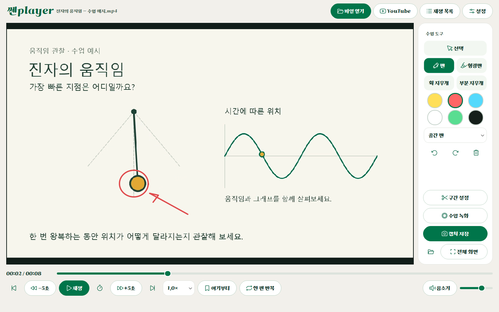
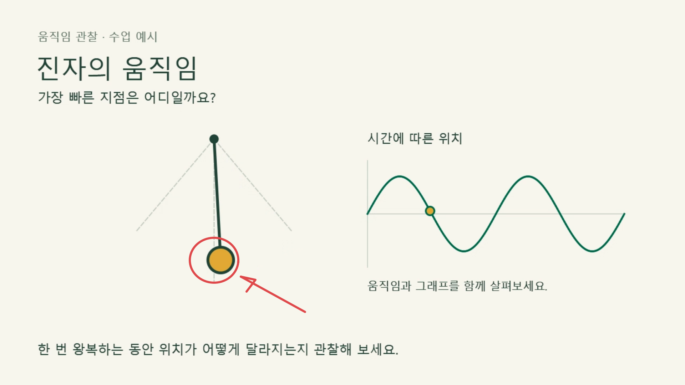
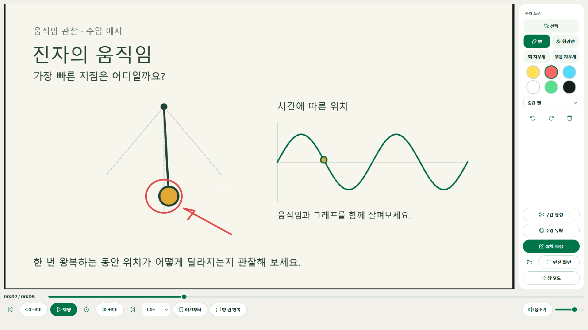

# 쎈player

Windows 수업용 영상 플레이어. 로컬 재생에는 광고가 없습니다. MOV를 재생하면서 영상 위에 쓰고, 영상과 필기를 PNG·MP4로 저장합니다. 쎈Lite·쎈Pick의 초록색과 따뜻한 중립색 디자인을 이어갑니다.

현재 버전: **1.0.0**. Windows x64, Python 3.12 / PySide6 6.10.2 / Qt FFmpeg backend. 사용자 PC에는 Python이나 별도 코덱 팩을 설치할 필요가 없습니다.

**[설치 파일 다운로드 및 버전 설명](https://github.com/HooniKims/ssen-player/releases/latest)** · 설치 EXE 또는 압축을 풀어 실행하는 포터블 ZIP을 제공합니다.



소개를 위해 직접 만든 진자 예시 영상을 실제 앱에서 재생한 화면입니다. 빨간 원과 화살표는 플레이어의 필기 기능으로 그렸습니다. 예시 영상은 설치 파일에 포함되지 않습니다.

영상의 한 장면을 설명할 때는 **필기와 캡처**, 설명 과정을 보관할 때는 **수업 녹화**, 같은 부분을 다시 볼 때는 **구간 반복**을 사용합니다. [전체 화면과 저장 결과를 포함한 앱 소개](https://github.com/HooniKims/ssen-player/releases/latest)에서 실제 화면을 확인할 수 있습니다.

## 사용

1. 설치형 `SsenPlayer-Setup-1.0.0.exe`를 실행하거나, 개발 빌드의 `dist/SsenPlayer/SsenPlayer.exe`를 실행합니다. 실행 파일만 따로 옮기지 말고 `_internal` 폴더도 함께 유지합니다.
2. **파일 열기** 또는 드래그 앤 드롭으로 영상을 엽니다. 여러 파일은 재생 목록에 추가됩니다.
3. 우측의 **펜 / 형광펜 / 지우개**를 선택합니다. 영상이 재생 중이거나 일시 정지된 상태에서 모두 쓸 수 있습니다.
4. **캡처 저장**을 누르면 현재 영상 프레임 + 표시 중인 자막 + 필기가 1920×1080 PNG로 저장됩니다. 여백에 쓴 필기도 포함하고 도구 모음은 제외합니다.
5. **설정 → 저장 폴더 변경**에서 저장 위치를 고릅니다. 기본값은 Windows 사진 폴더 아래 `쎈player`입니다.

아래는 **캡처 저장**으로 만든 실제 PNG입니다. 영상과 필기를 함께 저장하고 도구 모음은 제외합니다.



## YouTube · 구간 반복 · 수업 녹화

- **YouTube** 버튼에 링크를 붙이면 앱 안에서 임베드 재생합니다. 브라우저 엔진은 처음 YouTube를 열 때 로드합니다.
- **여기부터 → 여기까지**를 누르면 해당 부분을 반복합니다. **반복 해제**로 돌아갑니다.
- **구간 설정**에서 시작·종료 시간을 조절하거나 현재 위치로 지정합니다. 이름을 붙여 기억한 구간은 재실행 후에도 남으며 목록에서 선택하면 즉시 반복합니다.
- **이 구간을 MP4로 저장**은 원본의 선택 구간을 저장합니다. 로컬 파일과 다운로드 가능한 YouTube 영상에 적용하며 필기는 제외합니다.
- **수업 녹화**는 재생·일시정지 화면과 움직이는 필기를 함께 720p/20fps MP4로 저장합니다. 기본은 PC 소리이며 마이크는 선택 사항입니다. PC 소리에는 다른 앱의 소리도 포함됩니다.
- 재생 버튼 옆 **타이머 버튼**을 누르면 영상이 멈추고 화면에 5·4·3·2·1이 표시됩니다. 1이 사라지는 순간 재생되므로, 쎈컷 같은 다른 녹화 프로그램의 시작 버튼을 그 순간에 누르면 녹화와 재생을 맞출 수 있습니다.
- 캡처·구간 MP4·수업 녹화는 설정한 저장 폴더에 모입니다.
- **광고 차단·건너뛰기(실험)**는 Brave 계열 필터 엔진과 제한된 자체 필터, 제공되는 건너뛰기 버튼을 사용합니다. Brave 브라우저 전체를 내장한 것은 아니며 광고 없는 재생을 보장하지 않습니다.

## 화면 모드

| 모드 | 화면 |
| --- | --- |
| 창 모드 | 파일 열기, 재생 목록, 설정, 영상, 필기 도구 |
| 수업 전체 화면 | 우측 필기·캡처 바와 하단 재생 조작 유지 |
| 완전 전체 화면 | 영상과 이미 작성한 필기만 표시. 터치/마우스 이동 시 수업 도구 복귀 버튼이 잠시 나타남 |

`F11`은 창 → 수업 전체 화면 → 완전 전체 화면을 순환합니다. `Esc`는 이전 화면으로 돌아갑니다. 완전 전체 화면에서는 새 필기 대신 영상 보기에 집중하고, 수업 모드로 돌아오면 선택한 필기 도구가 복구됩니다.



## 구현한 기능

- 내장 FFmpeg + dav1d 재생: AV1, H.264, HEVC Main 10, ProRes, VP9, MPEG-4, MJPEG. MOV, MP4, MKV, AVI, WebM 샘플 검증. 별도 코덱 설치 불필요.
- 재생 / 정지, 5초 이동, 속도 0.5–2배, 음량, 음소거, 다음 / 이전, 한 편 반복, A–B 반복.
- 파일별 이어보기 위치 저장, 여러 파일 재생 목록.
- 마우스, Qt 터치, 태블릿 펜 입력. 6색, 3단계 두께, 형광펜, 획 지우개, 되돌리기 / 다시 실행.
- 필기는 영상 좌표를 기준으로 저장하므로 창 크기와 전체 화면 전환에 따라 위치가 어긋나지 않음.
- PNG 캡처는 동일한 프레임 렌더러로 합성. MOV 회전 정보 반영, 고유 파일명, 비동기 파일 저장.
- SRT / VTT / SMI 외부 자막, 같은 이름 자막 자동 탐색, 외부 자막 싱크 조절, 음성 / 내장 자막 트랙 선택.
- 앱을 켤 때 GitHub 릴리즈에서 새 버전 확인, "지금 업데이트 / 다음에" 선택, 설치 파일 크기·SHA-256 검증 후 설치.

## 현재 한계

- AV1 하드웨어가 없는 PC에서도 재생하도록 dav1d를 포함한 소프트웨어 디코더를 기본 사용합니다. 고해상도 영상은 CPU 성능에 영향을 받습니다. [검증 기록](docs/VALIDATION-0.2.1.md) 참고.
- YouTube는 인터넷이 필요합니다. 임베드 금지, 로그인·연령·지역 제한, 서비스 변경 등에 따라 재생 또는 구간 저장이 실패할 수 있습니다.
- 브라우저·녹화 엔진을 포함하면서 설치 용량이 증가했습니다. 로컬 재생 시 브라우저는 시작하지 않습니다.
- 녹화는 화면 합성 방식으로 장치 성능에 따라 프레임이 반복될 수 있습니다. 실제 전자칠판 장기 녹화와 마이크/스피커 동시 녹음은 현장 확인이 필요합니다.
- 업데이트 알림은 0.2.3부터 동작합니다. 0.2.2 이하에서는 릴리즈 페이지에서 최신 설치 파일을 한 번 직접 받아 설치해야 합니다. GitHub 인증 토큰은 앱에 넣지 않습니다.
- 카카오플레이어·곰플레이어의 모든 고급 기능을 구현한 상태는 아닙니다. ASS 스타일 렌더링, DVD 메뉴, 네트워크 스트림 UI, 정밀 색상/HDR 제어, 하드웨어별 최적화는 후속 범위입니다.
- 전자칠판 실물의 펜 지연, 필압, 손바닥 거부, 다중 모니터/DPI 조합은 아직 검증하지 않았습니다. Qt 합성 터치 이벤트와 마우스 테스트는 통과했습니다.
- 필기 원본은 앱 실행 중 파일별로 유지합니다. 재실행 후 복원되는 필기 프로젝트 저장은 없으며, 보관할 필기는 PNG로 캡처합니다.
- 모든 코덱과 손상된 파일, DRM 영상을 보장하지 않습니다. iPhone Dolby Vision/HDR 실제 원본의 색 정확도는 별도 확인이 필요합니다.
- 설치본은 현재 Windows 코드 서명이 없습니다.

## 개발 및 빌드

```powershell
python -m venv .venv
.venv/Scripts/python.exe -m pip install -r requirements-dev.txt
.venv/Scripts/python.exe scripts/fetch_codecs.py
.venv/Scripts/python.exe main.py
.venv/Scripts/python.exe -m unittest discover -s tests -v
```

재생/필기 통합 검증에는 개발용 `ffmpeg` CLI가 필요합니다. 테스트용 시스템 CLI와 별도로, 녹화·구간 저장용 FFmpeg 실행 파일을 앱에 포함합니다.

```powershell
powershell -ExecutionPolicy Bypass -File scripts/make_test_media.ps1
.venv/Scripts/python.exe scripts/codec_test.py
.venv/Scripts/python.exe scripts/smoke_test.py
.venv/Scripts/python.exe scripts/recording_test.py
.venv/Scripts/python.exe scripts/web_smoke.py
.venv/Scripts/python.exe scripts/youtube_clip_test.py
.venv/Scripts/python.exe -m PyInstaller --noconfirm --workpath build/output SsenPlayer.spec
# Inno Setup을 설치한 뒤 설치 파일 생성
& '<Inno Setup 경로>/ISCC.exe' build/installer.iss
```

실제 패키징된 앱 검증:

```powershell
dist/SsenPlayer/SsenPlayer.exe artifacts/test-media/classroom.mov --smoke-test-output artifacts/qa/packaged
dist/SsenPlayer/SsenPlayer.exe --feature-test-output artifacts/qa/packaged-features
```

업데이트 연결과 릴리즈 절차는 [RELEASING.md](RELEASING.md), 구성요소 출처는 [THIRD-PARTY-NOTICES](docs/THIRD-PARTY-NOTICES.txt)를 참고하세요.
